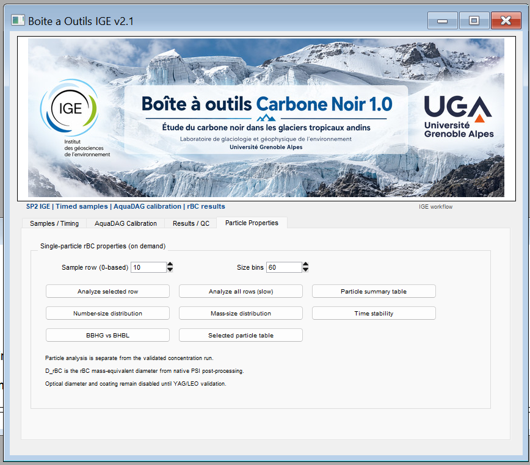

# SP2 IGE rBC Toolkit

<p align="center">
  
</p>

**Time-resolved refractory black carbon analysis for melted snow and ice using Igor Pro and the PSI SP2 Toolkit**

> **Research preview — v2.1.0-rc.1.** The current source has documented instrument-specific dependencies and uncompleted particle-statistics validation. **Do not interpret this repository as a fully validated analytical method or a turnkey installation.**

## Scope

This Igor Pro procedure collection supports selected steps in the analytical workflow for refractory black carbon (rBC) quantified by a Single Particle Soot Photometer (SP2) coupled to a liquid-sample nebulization system. The implementation was developed for processing laboratory measurements of glacier snow and ice meltwater. It extends, rather than replaces, the native PSI SP2 Toolkit.

Key functions are:

- **Time-window selection:** each record identifies an SP2 raw file, start/stop times, and explicit beginning/end trims.
- **Native SP2 processing:** invokes PSI Toolkit procedures for SP2 loading, particle-by-particle post-processing, and concentration extraction.
- **Liquid concentration conversion:** applies the configured liquid-sample, drain, and purge-air flows.
- **AquaDAG recovery correction:** derives channel-specific response slopes for BBHG and BHBL from standard runs, while retaining intercepts and regression diagnostics.
- **Analytical QC:** flags invalid acquisition windows, missing data, standard-recovery deviations, and insufficient independent blanks.
- **Optional particle analysis:** extracts particle counts, trigger rate, incandescence-derived mass, rBC mass-equivalent diameters, BBHG/BHBL summaries, saturation indicators, and PSI-derived size distributions.

## Software requirements

| Component | Tested/development target | Distribution |
|---|---|---|
| Igor Pro | **6.37** | Obtain under the applicable WaveMetrics license |
| PSI SP2 Toolkit | **4.111** (source also references 4.111a procedures) | Obtain from the original developer/instrument workflow |
| SP2 calibration | `root:SP2toolkit:CalibData:IGE_BACON_20210222_DMA_AQ` | Instrument-specific, **not bundled** |
| Raw input | `.sp2b` files and acquisition-time metadata | Supplied by the laboratory |
| Operating system | Original laboratory's Igor environment | Compatibility beyond that environment not established |

**This repository does not distribute Igor Pro, the PSI SP2 Toolkit, manufacturer software, or the original institutional experiment (`.pxp`).** Both Igor and PSI dependencies must be installed independently and licensed as applicable.

## Getting started

1. Read **[Installation](docs/INSTALL.md)** and **[Known limitations](docs/KNOWN_LIMITATIONS.md)**.
2. Open a **copy** of a functioning Igor Pro 6.37 experiment with PSI SP2 Toolkit 4.111 loaded and a valid instrument calibration folder.
3. Install **one** extension procedure only, following `docs/INSTALL.md`. For testing, the `src/*RC1_menu_fix.ipf` candidate includes an isolated menu-reference fix; the original file is preserved unchanged.
4. Compile and confirm that `SP2 IGE → Open main panel` is available. If compilation fails, do not proceed; record the error in a GitHub issue.
5. Prepare a timed sample table with raw-file/date references, start/stop times, trims, and **flow units**.
6. Run a pilot with standards and blanks. Review calibration/QC results before selecting natural samples.
7. Validate the optional `Particle Properties` workflow independently before using particle mass or size values in publications.

The program is **not a stand-alone SP2 calibration**. It uses mass calibrations that already exist in the native PSI SP2 Toolkit environment.

## Scientific definitions

- `BBHG`: broadband incandescence, high gain.
- `BBLG`: broadband incandescence, low gain.
- `BHBL`: PSI combined high-/low-gain incandescence product.
- `D10N/D50N/D90N`: number-weighted percentiles of **rBC mass-equivalent diameter**.
- `D10M/D50M/D90M`: rBC-mass-weighted percentiles of that same mass-equivalent diameter.
- The particle metrics **do not** represent optical diameter or physical coating thickness.

See the [technical specification](docs/TECHNICAL_SPEC.md), [data dictionary](docs/DATA_DICTIONARY.md), and [calibration protocol](docs/CALIBRATION.md).

## Validation status

| Component | Current evidence and restriction |
|---|---|
| Timed concentration | Reproduces the established laboratory workflow according to the historical validation notes; independent cross-installation verification remains necessary. |
| AquaDAG recovery/QC | Implemented in source. Laboratory-specific standards, blanks, calibration mass fraction, and physical uncertainty must be verified. |
| Particle statistics | Implemented; **not yet cleared for public production use**. A separate exported workbook raised physical consistency questions requiring a wave-to-export audit. |
| Optical diameter / coating | **Not supported** as validated results. Requires PSL scattering calibration, YAG/scattering checks, and LEO/model validation. |
| Other instruments | Not validated. A calibration path is hard-coded in v2.1. |

Run `python tests/validate_particle_csv.py <path/to/export.csv>` against exported particle summaries and follow the [validation plan](docs/VALIDATION.md). The CSV checker is a plausibility screen, **not** an Igor runtime or metrological calibration test.

## Repository map

```text
src/                                  original v2.1 procedure + menu-fix candidate
docs/INSTALL.md                       verified prerequisites and installation procedure
docs/TECHNICAL_SPEC.md                exact current workflow and mathematical relationships
docs/USER_GUIDE.md                     illustrative end-to-end laboratory workflow
templates/timed_input_example.csv      documented input example (not a native CSV importer)
docs/CALIBRATION.md                   AquaDAG standards, efficiency and blank QC
docs/DATA_DICTIONARY.md               output names, units and interpretation
docs/VALIDATION.md                    numerical, instrumental and regression tests
docs/KNOWN_LIMITATIONS.md             known issues and restrictions
docs/REPRODUCIBILITY.md               required run metadata and data publication rules
docs/ORIGINAL_V2_1_VALIDATION_NOTES.md historical notes from the original build
tests/validate_particle_csv.py        standard-library post-export sanity checker
CITATION.cff                          software citation metadata (review before release)
LICENSE-DECISION.md                   outstanding copyright/license decisions
```

## Citation and context

Please cite the software version used, the PSI SP2 Toolkit as appropriate, and relevant analytical-method publications. The original work of Lim et al. (2014) provides context for quantifying rBC in snow and ice by nebulization-SP2 (DOI: [10.5194/amt-7-3307-2014](https://doi.org/10.5194/amt-7-3307-2014)). See [References](docs/REFERENCES.md).

## Open-source status

This repository is being prepared for public release. **A copyright/third-party asset review and selection of an explicit open-source license remain necessary before declaring the code open source.** In particular, verify rights to the embedded institutional banner before uploading the source file. See [LICENSE-DECISION.md](LICENSE-DECISION.md).

## Disclaimer

This software supports scientific analysis; it does not certify instrumental performance or substitute for laboratory QA/QC. Calibrations, valid particle-size ranges, nebulization recovery, sample preparation, and uncertainty must be reported independently in scientific work.
